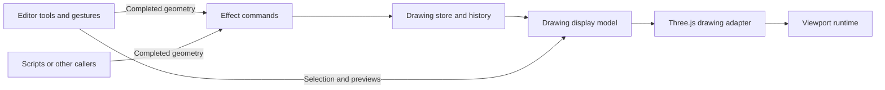

# Drawing architecture

The editor gathers input, commands change the document, the display model decides what appears, and the engine renders it.

`packages/drawing-core` owns the headless drawing model, store, commands, schemas, and MCP tool registration. It depends on Effect, Zod, and the MCP SDK. `packages/core` adds the React editor, display model, and rendering. `packages/web` hosts the editor in TanStack Start, and `packages/desktop` hosts it in Electron. `packages/cli` uses the headless package to edit local drawing files and run a standalone stdio MCP server.



| Layer | Location | Responsibility |
| --- | --- | --- |
| Drawing model | `packages/drawing-core/src/drawing/` | Shape data, geometry calculations, text alignment, symbol grouping, and history. No React, Three.js, or DOM dependency. |
| Commands | `packages/drawing-core/src/commands/` | Validate complete inputs, allocate IDs, normalize wires, and atomically publish document and history changes through Effect. |
| CLI and stdio | `packages/cli/src/` | Read and write local drawings, preserve undo history, coordinate file access, and expose the shared commands through the CLI and MCP. |
| Display | `packages/core/src/drawing/display.ts` | Describe shape geometry, transforms, appearance, selection outlines, open wire terminals, and previews as plain data. |
| Three.js engine | `packages/core/src/engine/drawing/`, `packages/core/src/engine/scene-viewport.ts` | Build meshes and textures, cache and dispose resources, operate cameras, render frames, and report viewport events. |
| React adapters | `packages/core/src/components/editor/useEditorScene.ts`, `packages/core/src/components/viewer/SceneViewport.tsx` | Bind rendering resource lifetimes and engine events to React. |
| Editor | `packages/core/src/components/editor/Editor2D.tsx` | Choose tools, collect pointer input, resolve snapping and text measurements, maintain selection and temporary geometry, and execute completed commands. |

Import the headless drawing, command, and MCP modules directly from `@ecad/drawing-core/...`. `packages/core` no longer re-exports them, and lint rejects the former `#/drawing/shapes.ts`-style paths. App-specific symbol catalogs, file conversion, text measurement, worksheet layout, and display descriptions remain in `packages/core/src/drawing/`.

## Running a command without an editor

Create a store and provide it to an Effect. Position is the shape center in millimetres, with positive Y upwards; rotation is in radians. Every placement input must include the final dimensions and line width.

```ts
import { Effect } from "effect";
import { placeRectangleEffect } from "@ecad/drawing-core/commands/drawing-commands.ts";
import { createDrawingStore, DrawingStore } from "@ecad/drawing-core/commands/drawing-store.ts";

const store = createDrawingStore();
const placement = placeRectangleEffect({
  x: 20,
  y: 30,
  width: 40,
  height: 15,
  rotation: 0,
  lineWidth: 0.2,
});

// Constructing placement has not changed the document.
const result = Effect.runSync(
  placement.pipe(Effect.provideService(DrawingStore, store)),
);

console.log(result.ids, store.getSnapshot().shapes);
```

`placeShapesEffect` accepts complete shapes without IDs, including symbols and text with measured dimensions. `replaceShapesEffect` accepts explicit IDs and their finished replacement geometry. `removeShapesEffect` accepts explicit IDs. `undoEffect`, `redoEffect`, and `jumpHistoryEffect` navigate document history. None reads the current tool, selection, viewport, pointer, or React state.

`rotateShapesEffect(ids, angle)` rotates explicit IDs around each shape's center using the current committed geometry. Its relative angle is in radians, positive counterclockwise, and defaults to `Math.PI / 2`. Rotation keeps component pins and labels together and leaves unselected wires in place. Wire rotations must keep segments horizontal or vertical.

Commands capture their input when constructed. They run only when executed with Effect, and can be composed in `Effect.gen`. Each command publishes one complete transaction; a sequence of separate commands produces separate undo steps. Invalid inputs fail with `InvalidDrawingCommand` and leave the document unchanged. Callers can handle that error with Effect combinators before running the program.

The current commands are synchronous, so the React event boundary uses `Effect.runSync` and handles the error channel there. Commands themselves never call `runSync`, `runPromise`, or a React hook. Asynchronous callers can provide the same service and use `runEffect` from `@ecad/drawing-core/lib/effect.ts`. See [Effect 3 execution boundaries](https://effect.website/docs/v3/getting-started/running-effects/).

## Previews and history

A rectangle drag starts with temporary editor geometry. Pointer movement updates that preview. Releasing a valid rectangle executes a placement command with its completed geometry; cancelling discards the preview. Moving and resizing follow the same pattern. A wire command runs once each completed segment or routed corner is known.

The store exposes stable, immutable snapshots and a subscription for React's `useSyncExternalStore`. Pass it to `<Editor2D store={store} />` to display and edit the same document used by external commands. Without this prop, each editor creates its own store.

In the web app, the editor's **Enable MCP** control connects this same store to a session-specific MCP endpoint. The server forwards complete operations to the browser, where Effect executes them. The desktop renderer sets `enableMcp={false}` because these endpoints belong to the web app. See [MCP access to an open drawing](mcp.md) for client setup, tool inputs, and session lifetime.

The standalone CLI and stdio server create a store from a local drawing for each operation. They reuse the same MCP tool definitions and commands, save successful edits, and preserve history in an adjacent file. The stdio server reloads the drawing on each call so it sees edits from other CLI processes. See [CLI and stdio access](mcp.md#cli-and-stdio-access).

An external document change cancels any active gesture and removes deleted IDs from the editor's selection. A stale preview cannot overwrite the external command when the pointer is released.

Document history contains only drawing data. The editor separately remembers selections for its own history navigation. Tool changes, selection, snapping, camera movement, and previews do not create document history entries. Shape IDs remain monotonic across undo branches.

## Symbol storage

`SymbolLibraryProvider` in `packages/core/src/symbol-library/storage.tsx` injects user storage and optional project storage into the shared editor. Core validates named library configuration and resolves enabled definitions, with project definitions taking precedence over user definitions. Without a provider, user libraries remain in memory for the editor session.

`packages/web/src/symbol-library/storage.ts` persists user configuration in project-independent localStorage. The desktop adapter calls the preload bridge; Electron's main process reads and atomically writes `~/.ecad/config.json` and resolves configured directory sources. Project storage persists `symbolLibraries` with drawing data and keeps existing standalone project symbols in the manifest. The project provider exposes both scopes, so opening a project never replaces or copies the user's libraries. See [symbol library configuration](symbol-format.md#user-and-project-configuration).

## Rendering ownership

`buildDrawingDisplay` accepts drawing data and explicit presentation state. Its output is suitable for testing without mounting React or creating a renderer. The Three.js adapter consumes those descriptions and owns cached geometry, materials, and textures. Removing shapes or previews releases their cached resources; disposing the adapter releases the worksheet and all remaining resources.

The viewport runtime owns the renderer, camera, controls, input listeners, and animation scheduling. React creates and disposes that runtime with the component lifetime and updates it through explicit methods. React effects handle this resource binding; they do not trigger document commands.

## Circuit documents and the graph editor

The circuit editor is the first stage of separating electrical connectivity from schematic geometry. Circuit files contain electrical data. Graph layouts are temporary view state. Existing `.ecaddraw` files retain their geometry-based connectivity and do not yet share connectivity with circuit files.

Create a circuit with **Add file → New circuit** in an open project. The Components picker uses the same enabled built-in, user, and project symbol libraries as the schematic editor. Choosing a symbol starts a placement preview; clicking the canvas creates a component and its position in one undo step. Escape cancels placement. Symbols without pins cannot become electrical components. The picker refreshes the catalog when opened. The editor autosaves and has no file menu. Project APIs can import circuit documents with optional graph layouts; duplicate circuit identities are rejected.

`packages/drawing-core/src/circuit/` owns the headless model, schemas, commands, store, and graph construction. It has no React, DOM, or renderer dependency. `packages/core/src/components/circuit/CircuitEditor.tsx` handles selection, temporary drags, inspection, and completed commands. The editor loads on demand through `Editor2D` when the project selects a circuit file, on both web and desktop. Its canvas fills the workspace. It shares the schematic editor's bottom toolbar groups. Components, History tools, and View tools open above the dock. Double-click a net name or component header to edit its attributes in place. Select a connection and press Delete to remove that pin's membership. Pin context menus provide connect, disconnect, and no-connect actions. Ctrl or Cmd-click connections to toggle them in a selection of several memberships, Shift-click to add them, or Ctrl or Cmd + Shift-click to remove them, then use their context menu to split them into a new net. There is no floating inspector. The Pan tool and middle-drag move the viewport without editing the circuit.

A `.ecadcircuit` file is JSON with `format: "ecad-circuit"` and `version: 1`. It contains a stable document ID, name, revision, components, nets, and `noConnectPinIds`. Each component has a stable ID, editable reference and value, part identity and optional part revision, and an embedded snapshot of its pins. Each pin has a stable ID, name, number, and electrical type. Components created from symbols retain the source library scope and ID in `part.library`, and each pin retains its definition child ID in `sourcePinId`. Unnumbered symbol pins receive sequential numbers. The circuit stores pin snapshots, so later library edits cannot change an existing component's connectivity. Symbol pins currently have no electrical type metadata, so these component pins start as passive. Changing a symbol library cannot alter these pins.

A net has a stable ID, `names`, and `pinIds`. Its first name is the display name; the remaining names are aliases. Names are trimmed and case sensitive. Names must be unique across the circuit, pins must exist, and a pin can belong to at most one net. Pins without memberships are unconnected. A no-connect declaration records an intentionally unconnected pin and cannot coexist with membership. Empty and one-pin nets are valid. Add net places a standalone net and opens its name field. Removing its last membership preserves the net and its position. Only explicit net deletion or a merge removes a net.

Graph positions and collapse state live in memory for the current editing session. They support undo but never enter saved circuit files. Opening a circuit generates a deterministic layout from its components and net memberships and fits it to the viewport.

The graph displays components as boxes, their pins as nodes, and each net as a shared node. Each membership produces one edge, so an N-pin net has N edges. Pin sides follow the net positions to keep connections visible. Crossings have no electrical effect. Unnamed nets derive their labels from distinct member pin names, or component references and pin numbers when no useful names exist. Labels update with membership changes, use up to three names, and add suffixes to avoid duplicate labels or manually assigned names and aliases. These derived labels are not saved as explicit names. Editing a label assigns a manual name; clearing it restores automatic naming. Each alias has a separate field, so commas remain part of a name. Add alias appends a field without committing other edits. Choosing a component or Add net transfers focus to placement in the graph. Placement starts at the viewport center. Arrow keys move the snapped preview, Shift moves ten grid steps, Enter or Space places, and Escape cancels. A placement is one undo command. Dragging headers or net nodes updates graph positions only. Dragging a pin onto another pin or a net node commits a connection, with a temporary preview while dragging. Dropping onto a named net keeps that target net. Component top-left corners and net centers snap to the visible background dots during placement, dragging, arrow-key movement, and Untangle. The grid coarsens at low zoom, and these edits use that same spacing. Snapping changes only graph positions. Each component has a collapse control at the bottom. Collapsed cards hide all pins and route their membership edges to a shared point on each side without joining their nets. Each connection uses the side facing its net. Expanding restores the full pin stack. Card height and wire endpoints animate for 180 ms, unless reduced motion is enabled. Collapse state supports undo without changing circuit contents or revisions. Untangle and Fit use the visible card heights. Arrow keys move a focused node. The Untangle button searches several component orders and column counts, places nets in gaps, and chooses a grid-aligned result by node overlap, wires passing through other components, sampled curve crossings, and wire length. Small circuits also try empty grid slots and refine component swaps and net placement. It keeps the current arrangement when no candidate scores better. Zoom percentages and limits use the actual SVG screen scale. Fit resets zoom to 100%, one CSS pixel per graph unit, and centers the graph, even if the graph is larger than the viewport. Opening a circuit and Untangle still frame the complete layout. These actions change only the viewport.

`createCircuitStore(file, options)` exposes immutable snapshots, subscription, `execute(command)`, `undo()`, and `redo()`. It keeps at most 100 undo entries. Commands validate a complete result before publishing; failure preserves both documents and history. Invalid commands, results, and synchronizations throw `CircuitCommandError`, an Effect tagged error with a stable `reason` and a display `message`. Schema failures join their issue messages and keep the Zod error as `cause`. An unknown command type fails with the `unknown-command` reason, and the command switch must handle every `CircuitCommand` type to compile. Connecting unconnected pins and splitting a net allocate net IDs with `options.createId`, which defaults to `crypto.randomUUID`. A store created without a file also takes its circuit ID from `createId`. Tests inject a counter for deterministic results. Electrical edits increment the circuit revision; layout edits preserve the entire circuit document. Undo restores the previous document revision, so the revision is not an external concurrency token.

Connect merges the selected pins' nets into the explicitly selected target net, or the first existing net when no target is supplied. The surviving net keeps its ID. An explicit target keeps its display name first, and the other names become aliases. Connecting an intentional no-connect pin clears that declaration. Split moves an explicitly selected proper subset into a new unnamed net. Disconnect removes selected memberships without connecting the detached pins to one another. Deleting a component removes its pins, memberships, no-connect declarations, and obsolete graph positions. Net and component attributes never act as identities.

No-connect declarations and the paired schematic's no-connect markers stay in sync. Declaring a pin no-connect in the circuit view puts a marker on that pin's terminal, on the symbol's page. Clearing the declaration, or connecting the pin, deletes the markers that marked it, including a marker on the pin's wire stub. Markers drawn inside a symbol definition stay. In the other direction, a schematic marker on an unconnected pin's terminal, or on a wire that reaches only that pin, declares the pin no-connect, and deleting the marker clears it. A marker on a wired pin declares nothing, because a pin cannot be both connected and no-connect. ERC reports that clash. Moving or rotating a symbol leaves its markers in place, so the moved pins lose their declarations on the next save, and ERC reports the left-behind markers as stray. If a circuit edit is saved together with the move, the sync places a new marker on the pin and the old one stays where it was. Deleting a symbol in the schematic also leaves its markers in place. Deleting the component in the circuit view removes them.

The project manifest optionally lists circuit paths in `circuits`. Browser storage writes electrical circuit JSON into a new revision and publishes the manifest last. Desktop storage writes visible circuit files, retains old bytes until the manifest commits, and restores them on failure. Desktop saves reject external electrical file changes. The project session queues autosave immediately after an electrical edit. It coalesces queued edits and drains changes made during an in-flight save before completing. Store identities track unsaved documents. Linked PCB synchronization runs only for changed PCB inputs or invalidated symbol libraries. Resolved libraries remain cached within the session until project library inputs change, the library storage publishes an update, or the project reloads. Failed saves retain dirty state for an explicit retry or the next edit. Moving, collapsing, or untangling nodes does not mark the circuit dirty or write files. Undo history and view state survive switching files in the current session and reset after reload.

### Changes from other programs

The desktop app watches the open project for changes that other programs make, such as the CLI, a text editor, or `git checkout`. The Electron main process watches the project directory and each directory that holds a listed drawing or symbol, without recursion. It ignores temporary, lock, history, and asset files. After 300 ms without further events, it compares each listed file with the bytes the project last read or wrote. This window's own saves therefore never count as changes. Missed events are caught when the window regains focus. When a file differs, the renderer asks the main process to re-read the project, then replaces only the documents whose files changed. A changed document starts a new undo history. Every other open document keeps its store, history, selection, and camera, and the editor does not remount. A document whose file was removed closes, and the editor returns to the main drawing. A toast names the reloaded documents.

Unsaved local edits are never replaced. If any edit is pending when a change arrives, or an edit happens while the files are read, the project enters the existing conflict state. Saving pauses until **Reload from disk**. If a changed file cannot be read, for example while another program is partway through writing it, the open documents stay unchanged and a warning toast explains why. The next save then reports a conflict. Browser projects and untitled desktop projects are not watched.

The next migration stage is to bind schematic symbol occurrences and route attachments to these component, pin, and net IDs. Geometry-based extraction remains authoritative only for legacy drawings until that binding exists. Circuit files are currently edited through the headless store or graph editor, rather than the drawing CLI/MCP commands.

The view switch carries the selection to the paired view. A schematic symbol selects its circuit component, a symbol's pin selects the circuit pin, and wires, net labels and net symbols select their circuit net. A schematic selection that stands for more than one circuit item, or for none, leaves the circuit view without a selection. In the other direction, a component selects all its unit symbols, a pin selects its symbol and pin, a net selects its wires, net labels and net symbols, and several selected connections select their symbols. Locked shapes stay unselected. Switching back before selecting anything else restores the original selection, so a single wire stays a single wire. Reloading files that another program changed cancels a pending selection handoff and that restore. The mapping runs after the switch's autosave, against the current documents, and lives in `packages/core/src/circuit/selection-sync.ts`. Each view keeps its own camera. Opening a file from the sidebar starts with an empty selection.

Editor file selections invalidate earlier asynchronous circuit opens. A delayed circuit load cannot replace a subsequently selected drawing, symbol, asset, or circuit.
