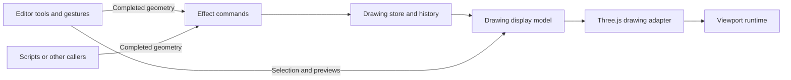

# Drawing architecture

The editor gathers input, commands change the document, the display model decides what appears, and the engine renders it.



| Layer | Location | Responsibility |
| --- | --- | --- |
| Drawing model | `src/drawing/` | Shape data, geometry calculations, symbols, text layout, worksheet layout, history, and display descriptions. No React, Three.js, or DOM dependency. Text layout accepts a measurement function. |
| Commands | `src/commands/` | Validate complete inputs, allocate IDs, normalize wires, and atomically publish document and history changes through Effect. |
| Display | `src/drawing/display.ts` | Describe shape geometry, transforms, appearance, selection outlines, open wire terminals, and previews as plain data. |
| Three.js engine | `src/engine/drawing/`, `src/engine/scene-viewport.ts` | Build meshes and textures, cache and dispose resources, operate cameras, render frames, and report viewport events. |
| React adapters | `src/components/editor/useEditorScene.ts`, `src/components/viewer/SceneViewport.tsx` | Bind rendering resource lifetimes and engine events to React. |
| Editor | `src/components/editor/Editor2D.tsx` | Choose tools, collect pointer input, resolve snapping and text measurements, maintain selection and temporary geometry, and execute completed commands. |

The former editor model and rendering helper paths re-export their new implementations for existing consumers.

## Running a command without an editor

Create a store and provide it to an Effect. Position is the shape center in millimetres, with positive Y upwards; rotation is in radians. Every placement input must include the final dimensions and line width.

```ts
import { Effect } from "effect";
import { placeRectangleEffect } from "#/commands/drawing-commands";
import { createDrawingStore, DrawingStore } from "#/commands/drawing-store";

const store = createDrawingStore();
const placement = placeRectangleEffect({
  x: 20,
  y: 30,
  width: 40,
  height: 15,
  rotation: 0,
  lineWidth: 0.2,
});

// Constructing placement has not changed the document.
const result = Effect.runSync(
  placement.pipe(Effect.provideService(DrawingStore, store)),
);

console.log(result.ids, store.getSnapshot().shapes);
```

`placeShapesEffect` accepts complete shapes without IDs, including symbols and text with measured dimensions. `replaceShapesEffect` accepts explicit IDs and their finished replacement geometry. `removeShapesEffect` accepts explicit IDs. `undoEffect`, `redoEffect`, and `jumpHistoryEffect` navigate document history. None reads the current tool, selection, viewport, pointer, or React state.

Commands capture their input when constructed. They run only when executed with Effect, and can be composed in `Effect.gen`. Each command publishes one complete transaction; a sequence of separate commands produces separate undo steps. Invalid inputs fail with `InvalidDrawingCommand` and leave the document unchanged. Callers can handle that error with Effect combinators before running the program.

The current commands are synchronous, so the React event boundary uses `Effect.runSync` and handles the error channel there. Commands themselves never call `runSync`, `runPromise`, or a React hook. Asynchronous callers can provide the same service and use `runEffect` from `src/lib/effect.ts`. See [Effect 3 execution boundaries](https://effect.website/docs/v3/getting-started/running-effects/).

## Previews and history

A rectangle drag starts with temporary editor geometry. Pointer movement updates that preview. Releasing a valid rectangle executes a placement command with its completed geometry; cancelling discards the preview. Moving and resizing follow the same pattern. A wire command runs once each completed segment or routed corner is known.

The store exposes stable, immutable snapshots and a subscription for React's `useSyncExternalStore`. Pass it to `<Editor2D store={store} />` to display and edit the same document used by external commands. Without this prop, each editor creates its own store.

The editor's **Enable MCP** control connects this same store to a session-specific MCP endpoint. The server forwards complete operations to the browser, where Effect executes them. See [MCP access to an open drawing](mcp.md) for client setup, tool inputs, and session lifetime.

An external document change cancels any active gesture and removes deleted IDs from the editor's selection. A stale preview cannot overwrite the external command when the pointer is released.

Document history contains only drawing data. The editor separately remembers selections for its own history navigation. Tool changes, selection, snapping, camera movement, and previews do not create document history entries. Shape IDs remain monotonic across undo branches.

## Rendering ownership

`buildDrawingDisplay` accepts drawing data and explicit presentation state. Its output is suitable for testing without mounting React or creating a renderer. The Three.js adapter consumes those descriptions and owns cached geometry, materials, and textures. Removing shapes or previews releases their cached resources; disposing the adapter releases the worksheet and all remaining resources.

The viewport runtime owns the renderer, camera, controls, input listeners, and animation scheduling. React creates and disposes that runtime with the component lifetime and updates it through explicit methods. React effects handle this resource binding; they do not trigger document commands.
