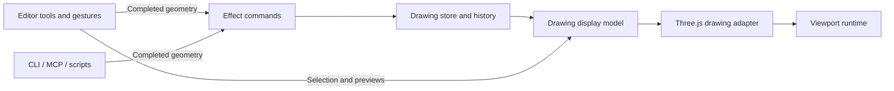

# Drawing architecture

In ECAD, the editor collects pointer and keyboard input, Effect commands commit document changes, the display model builds plain rendering descriptions, and the Three.js engine draws them.

`packages/drawing-core` owns the headless drawing, circuit, footprint, and board models, stores, Effect commands, schemas, ERC/DRC, and MCP tool registration (depending only on Effect, Zod, and the MCP SDK). `packages/core` adds the Solid 2.0 UI, display models, format parsers, workers, and Three.js renderer. `packages/web` hosts the app in TanStack Start, `packages/desktop` hosts it in Electron, and `packages/cli` edits local drawing files and runs the stdio MCP server.



## Layer boundaries

| Layer | Location | Responsibility |
| --- | --- | --- |
| Drawing model | `packages/drawing-core/src/drawing/` | Shape data, geometry math, text alignment, symbol grouping, named nets, and history. No UI, Three.js, or DOM dependencies. |
| Commands | `packages/drawing-core/src/commands/` | Validate complete inputs, allocate IDs, normalize wires, and atomically publish document and history updates via Effect. |
| CLI & stdio | `packages/cli/src/` | Read/write local `.ecaddraw` files, persist undo history, coordinate file locking, and expose shared commands over CLI and MCP. |
| Display | `packages/core/src/drawing/display.ts` | Produce plain data descriptions of shapes, transforms, appearance, selection outlines, open wire terminals, and previews. |
| Three.js engine | `packages/core/src/engine/drawing/`, `packages/core/src/engine/scene-viewport.ts` | Build meshes and textures, batch draws, cache/dispose GPU resources, operate cameras, and emit viewport events. |
| Solid adapters | `packages/core/src/components/editor/useEditorScene.ts`, `packages/core/src/components/viewer/SceneViewport.tsx` | Bind rendering resource lifetimes and viewport events to Solid reactive owners. |
| Editor | `packages/core/src/components/editor/Editor2D.tsx` | Manage tools, pointer gestures, snapping, text measurement, selection, previews, and command execution. |

Import headless drawing, command, and MCP modules directly from `@ecad/drawing-core/...`. `packages/core` does not re-export them (lint rejects legacy `#/drawing/shapes.ts`-style paths). App-specific symbol catalogs, file conversion, text measurement, worksheet layout, and display builders remain in `packages/core/src/drawing/`.

## Headless commands

Commands accept complete, resolved geometry in millimetres (shape center `(x, y)`, positive Y up, rotation in radians) and never inspect active tools, selection, viewport, or pointer state.

```ts
import { Effect } from "effect";
import { placeRectangleEffect } from "@ecad/drawing-core/commands/drawing-commands.ts";
import { createDrawingStore, DrawingStore } from "@ecad/drawing-core/commands/drawing-store.ts";

const store = createDrawingStore();
const placement = placeRectangleEffect({
  x: 20,
  y: 30,
  width: 40,
  height: 15,
  rotation: 0,
  lineWidth: 0.2,
});

// Constructing the Effect does not mutate the store.
const result = Effect.runSync(
  placement.pipe(Effect.provideService(DrawingStore, store)),
);

console.log(result.ids, store.getSnapshot().shapes);
```

- **Available commands** — `placeRectangleEffect`, `placeShapesEffect`, `replaceShapesEffect`, `rotateShapesEffect` (relative radians counterclockwise, default `Math.PI / 2`; wires require multiples of `Math.PI / 2`), `removeShapesEffect`, `setPagesEffect`, `setSheetEffect`, `moveShapesToPageEffect`, `undoEffect`, `redoEffect`, and `jumpHistoryEffect`.
- **Transactions and errors** — Each command publishes one undo step. Invalid inputs fail with `InvalidDrawingCommand` and leave the document unchanged.
- **Execution boundaries** — Commands never call `runSync`, `runPromise`, or Solid primitives internally. UI event handlers run synchronous commands with `Effect.runSync`; async callers use `runEffect` from `@ecad/drawing-core/lib/effect.ts`.

## Previews, store, and history

Interactive gestures (drawing, moving, resizing, routing) update temporary editor preview geometry during pointer motion and commit a single command on completion. Cancelling discards the preview.

- `createDrawingStore()` exposes immutable snapshots and a subscription bridged to Solid via `fromExternalStore` (`packages/core/src/lib/external-store.ts`). Pass `<Editor2D store={store} />` to share a store with external callers.
- An external document change cancels active gestures and prunes deleted IDs from selection so a stale preview cannot overwrite external edits.
- Document history stores only drawing data (capped at 100 nodes across branches) with monotonic shape IDs. Selection, tool state, snapping, camera, and previews stay outside history.

## Symbol storage, footprints, and boards

- **Symbol libraries** — `SymbolLibraryProvider` (`packages/core/src/symbol-library/storage.tsx`) injects user and optional project library storage. Enabled project definitions override user definitions by ID. Web persists user libraries in `localStorage`; desktop stores `symbol-libraries.json` in the platform config directory and resolves local directory sources in Electron's main process. See [docs/symbol-format.md](symbol-format.md#user-and-project-configuration).
- **Footprints** — Reuse the drawing store, commands, and canvas with optional `layer`, `pad`, `via`, and `hole` shape fields. `@ecad/default-footprints` and `@ecad/default-models` load on demand. See [docs/footprints.md](footprints.md).
- **Boards (PCBs)** — Extend the footprint canvas with placed footprints, tracks, vias, and copper zones. Headless netlist, connectivity, DRC, schematic sync, and autorouting live in `packages/drawing-core/src/board/`; file format, zone fills, display, and Gerber export live in `packages/core/src/board/`. See [docs/pcb.md](pcb.md).

## Rendering ownership

`buildDrawingDisplay` converts drawing data and presentation state into plain display objects suitable for headless testing. The Three.js adapter owns cached geometry, materials, and textures, releasing resources when shapes disappear or the adapter disposes. The viewport runtime owns the WebGL renderer, camera, controls, listeners, and animation loop; Solid effects bind lifecycle only and never dispatch document commands.

## Dialogs

`AppDialog` (`packages/core/src/components/ui/Dialog.tsx`) renders over a dimmed backdrop on web, and in a frameless modal child window on desktop (opened via `window.open` with an `ecad-dialog-` window name prefix, rendered through a Solid `Portal` so it retains page state, context, stylesheets, and `data-theme`).

Because desktop dialog elements belong to a child `window` while script executes in the parent realm:

- Check `element instanceof element.ownerDocument.defaultView.HTMLElement` rather than `element instanceof HTMLElement`.
- Avoid code that queries the global `document` (for example, roving focus in tab lists).
- Capture-phase handlers on parent ancestors must ignore events targeting another document.

## Web Workers

Heavy non-DOM work runs in ES-module Web Workers (`worker.format: "es"` in Vite configs) so the UI stays responsive:

| Workload | Worker | Lifetime |
| --- | --- | --- |
| Gerber, ZIP, STEP, and KiCad import | `formats/**/*.worker.ts` | Single import |
| Zone fills, ratsnest, DRC, Gerber/drill export | `board/analysis.worker.ts` | Open board (loads Gerber/ZIP/glyph tables on first export) |
| Circuit graph layout (`Untangle` & initial open) | `circuit/untangle.worker.ts` | Warm for 60 s after completion |
| Drawing export (SVG, PNG, PDF) | `drawing/export.worker.ts` | Started when export dialog opens; warm for 60 s |

- `inWorkerOrHere` (`packages/core/src/lib/worker-task.ts`) manages one-off workers; `keepWarm` parks finished workers for 60 s. Workers reply with `{ result }`, `{ error }`, or `{ unavailable: true }`. If `Worker` is unavailable, crashes, returns `unavailable`, or exceeds 30 s, the helper terminates it and falls back to running the function on the page (used by Node tests). Aborted tasks never fall back.
- The export worker loads JetBrains Mono into its own `FontFaceSet` and measures text on an `OffscreenCanvas`. PNG export decodes the worker's SVG to an `ImageBitmap` on the page and transfers it back to the worker for PNG encoding; PDF export runs entirely in the worker, loading `drawing/export-pdf.ts` and glyph outlines on first use.
- Interactive wire rerouting during drags, 3D board mesh updates, rendering, ERC, and autosave stay on the page thread.

## Circuits and the graph editor

The circuit model (`packages/drawing-core/src/circuit/`) separates electrical connectivity from schematic geometry. `CircuitEditor` (`packages/core/src/components/circuit/CircuitEditor.tsx`) loads on demand when a circuit is opened.

- **Document model** — `.ecadcircuit` (and embedded circuit sections in `.ecaddraw`) is JSON (`format: "ecad-circuit"`, `version: 1`) containing a stable document ID, name, revision, components (each with embedded pin snapshots so library edits never break existing connectivity), nets (display name + aliases + `pinIds`), and `noConnectPinIds`. Graph positions and collapse state live in memory only (undoable, never persisted).
- **Store and commands** — `createCircuitStore(file, options)` maintains immutable snapshots and up to 100 undo entries, throwing `CircuitCommandError` on invalid commands or schema failures. Electrical edits increment the revision; layout edits do not.
- **No-connect sync** — Circuit no-connect declarations and paired schematic no-connect markers stay synchronized on save.
- **Linked view mounting** — A circuit's schematic, circuit, and PCB editors stay mounted together. After 1 second of user inactivity, the session preloads the other two views hidden and inert so view switches are instant. Hidden circuit views release their SVG graph and re-render on show to keep DOM node counts low.
- **Selection sync** — `packages/core/src/circuit/selection-sync.ts` maps selections across views after autosave: symbols ↔ components, pins ↔ pins, wires/labels ↔ nets (between schematic and circuit), and symbols/components ↔ placed footprints (with PCB). Switching back without changing selection restores the original selection.

## External file watching (desktop)

Electron's main process watches the open project directory and each directory containing a listed drawing, symbol, or footprint (non-recursively, ignoring temp, lock, history, and asset files). After a 300 ms quiet period (or on window focus), it compares file bytes against the last read/written snapshot:

- Only changed documents reload (starting fresh undo history); unchanged open documents keep their store, history, selection, and camera without remounting.
- Removed files close and return to the main drawing or start page.
- If local edits are pending (or occur mid-read), the project enters a conflict state and pauses saves until **Reload from disk**. Unreadable files show a warning toast and keep open documents intact.
- Browser projects and untitled desktop projects are not watched.
