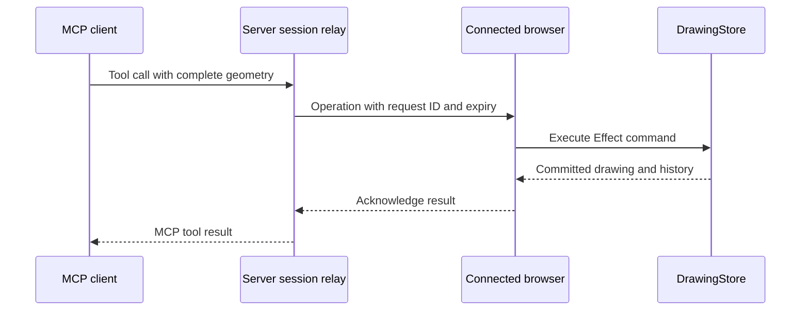

# MCP access to an open drawing

MCP clients can read and edit the drawing open in `/editor`. MCP starts disabled. Each enabled editor has its own endpoint and bearer token, and commands run against that editor's existing `DrawingStore`.

## Connect a client

1. Start the app with `npm run dev` and open `http://localhost:3000/editor`.
2. Click **Enable MCP** and wait for **Connected to this drawing**.
3. Click **Copy configuration**. Add the copied endpoint and authorization header to an MCP client that supports Streamable HTTP and custom headers.
4. Keep the drawing tab open while using the client. Click **MCP connected** to hide or show settings without disconnecting. Click **Disable MCP** in the settings panel to revoke access.

The panel provides a configuration in this form. Use the actual URL and token copied from the drawing:

```json
{
  "mcpServers": {
    "ecad": {
      "url": "http://localhost:3000/mcp/editor/<session-id>",
      "headers": {
        "Authorization": "Bearer <session-token>"
      }
    }
  }
}
```

Client configuration formats vary; the endpoint uses HTTP and requires the `Authorization: Bearer ...` header. The token grants read and edit access to this drawing. The client must be able to reach the app at the copied URL.

The existing `/mcp` endpoint remains the todo demo, with its `addTodo` tool. Drawing clients use the session-specific `/mcp/editor/<session-id>` endpoint.

## Tools and coordinates

Coordinates and dimensions are millimetres. `x` and `y` specify the shape center, positive Y points upward, and `rotation` is in radians. Width, height, rotation, and line width must be resolved before sending a placement command. Commands do not consult the active tool, pointer, selection, or snap setting.

| Tool | Arguments | Behavior |
| --- | --- | --- |
| `getDrawing` | `{}` | Read committed shapes, `nextShapeId`, and history entries. |
| `placeRectangle` | `x`, `y`, `width`, `height`, `rotation`, `lineWidth` | Place one rectangle and allocate its ID. |
| `placeShapes` | `shapes`, optional `label` | Place complete shapes without top-level IDs in one history transaction. |
| `replaceShapes` | `shapes`, optional `label`, optional `targetIds` | Replace complete geometry for explicit existing IDs. `targetIds` prefer IDs to retain when wires merge. |
| `removeShapes` | `ids`, optional `label` | Remove explicit existing IDs. |
| `undo` | `{}` | Restore the previous history entry. |
| `redo` | `{}` | Restore the preferred next history entry. |
| `jumpHistory` | `id` | Restore an existing history entry, including another branch. |

For example, send this tool call to place a 40 × 15 mm rectangle centered at `(20, 30)`:

```json
{
  "name": "placeRectangle",
  "arguments": {
    "x": 20,
    "y": 30,
    "width": 40,
    "height": 15,
    "rotation": 0,
    "lineWidth": 0.2
  }
}
```

All six fields are required. The command commits immediately as one undo step and appears in the open editor. It leaves the selected tool unchanged.

`placeShapes` supports rectangles, circles, triangles, orthogonal wires, pins, text, and symbols. Pins have a string `name`, which defaults to empty when omitted, including pins inside symbols. Text includes its content, font size, and already measured width and height. Symbol children use coordinates relative to the symbol center and IDs local to the symbol. Read `getDrawing` before replacing or removing shapes, and include every connected neighbor that a replacement needs to move. The commands validate geometry and normalize overlapping wires; they do not infer an editor gesture.

Successful results include the current drawing in `structuredContent` and as JSON text. Mutations also return affected IDs and an ID mapping where applicable. `getDrawing` includes history entry IDs, labels, parents, children, and preferred redo branches. It excludes temporary previews, selection, and camera state. Invalid input produces an MCP error and leaves drawing data and history unchanged. The tool schemas returned by `tools/list` describe the complete input and output formats.

UI edits and MCP edits share the same history. An external mutation cancels an unfinished gesture before its preview can overwrite the command.

## Session lifetime

Disabling MCP, closing the tab, leaving the editor, or losing its command stream revokes the session credentials. Enabling MCP again creates a new endpoint and token. Update the client's configuration after reconnecting. Separate editor tabs have separate sessions and drawings.

The browser does not automatically reconnect or replay commands. A timeout, caller cancellation, or failed acknowledgement can occur after a command has reached the browser. Cancellation does not retract a delivered command or roll back its mutation. Inspect the drawing before retrying; after enabling a fresh connection, use `getDrawing` to check the committed state. Disabling MCP does not undo completed edits.

## Implementation and hosting

The MCP server validates tool arguments and forwards a complete operation to the connected browser. The browser executes its Effect command with the same `DrawingStore` used by `Editor2D`, then acknowledges the result. React subscriptions update the display and Three.js renderer.



| Location | Responsibility |
| --- | --- |
| `src/mcp/drawing-protocol.ts` | Shared operation schemas, reply schemas, and Effect command execution. |
| `src/mcp/drawing-server.ts` | MCP tool registration and protocol results. |
| `src/mcp/editor-connection.ts` | Browser command stream, validation, execution, and acknowledgement. |
| `src/services/server/editor-sessions.ts` | Session credentials, connected browsers, pending requests, and timeouts. |
| `src/services/server/editor-mcp.ts` | HTTP handlers for session creation, browser connections, and MCP requests. |
| `src/components/editor/McpControls.tsx` | Explicit enable/disable controls and client configuration. |

`POST /api/editor-mcp` creates a session. The browser connects to `/api/editor-mcp/<session-id>` using a separate editor token, receives newline-delimited operations, and posts acknowledgements there. MCP clients authenticate to `/mcp/editor/<session-id>` with the copied MCP token. The browser token is not included in the client configuration.

The relay currently stores sessions and pending requests in one server process. It stores no drawing document. All creation, browser stream, acknowledgement, and MCP requests for a session must reach that same process. Deploy with one process, or provide session-aware sticky routing across both browser and MCP client requests. Independently routed serverless requests or multiple workers need a shared relay implementation. Server restarts invalidate existing connections.

Keep the browser response stream open through any reverse proxy and disable response buffering for that endpoint. Idle streams send a heartbeat every 15 seconds. Drawing commands currently have a 15-second acknowledgement timeout.

See [drawing architecture](architecture.md) for command and rendering boundaries, and [Effect integration](effect.md) for execution and resource lifetimes.
