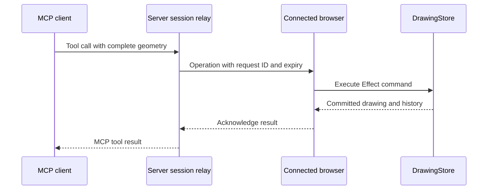

# MCP access to drawings

The standalone CLI and stdio MCP server read and edit local `.ecaddraw` files under Node. See [CLI and stdio access](#cli-and-stdio-access) below.

MCP clients can also read and edit the drawing open in the web app's `/editor`. Web editor MCP starts disabled. Each enabled editor has its own endpoint and bearer token, and commands run against that editor's existing `DrawingStore`. The desktop app uses the same editor with MCP controls hidden; it does not host these HTTP endpoints.

## Connect a client

1. Start the app with `pnpm run dev` and open `http://localhost:3000/editor`.
2. Click **Enable MCP** and wait for **Connected to this drawing**.
3. Click **Copy configuration**. Add the copied endpoint and authorization header to an MCP client that supports Streamable HTTP and custom headers.
4. Keep the drawing tab open while using the client. Click **MCP connected** to hide or show settings without disconnecting. Click **Disable MCP** in the settings panel to revoke access.

The panel provides a configuration in this form. Use the actual URL and token copied from the drawing:

```json
{
  "mcpServers": {
    "ecad": {
      "url": "http://localhost:3000/mcp/editor/<session-id>",
      "headers": {
        "Authorization": "Bearer <session-token>"
      }
    }
  }
}
```

Client configuration formats vary; the endpoint uses HTTP and requires the `Authorization: Bearer ...` header. The token grants read and edit access to this drawing. The client must be able to reach the app at the copied URL.

The existing `/mcp` endpoint remains the todo demo, with its `addTodo` tool. Drawing clients use the session-specific `/mcp/editor/<session-id>` endpoint.

## CLI and stdio access

The `@ecad/cli` workspace runs independently under Node. It uses `@ecad/drawing-core` for the drawing model, Effect commands, schemas, and MCP tool registration. The web editor uses the same implementation.

```bash
export ECAD_DRAWING="$PWD/drawing.ecaddraw"
pnpm --silent cli tools
pnpm --silent cli getDrawing
pnpm --silent cli placeRectangle '{"x":20,"y":30,"width":40,"height":15,"rotation":0,"lineWidth":0.2}'
pnpm --silent cli rotateShapes '{"ids":[1],"angle":1.5707963267948966}'
printf '%s' '{"ids":[1]}' | pnpm --silent cli removeShapes -
pnpm --silent cli undo
```

`--drawing <path>` overrides `ECAD_DRAWING`. The default is `drawing.ecaddraw` in the current directory. Its parent directory must exist. A missing drawing starts empty, and the first successful edit creates it. Reading an empty drawing or listing tools creates no drawing file.

All nine drawing tools are available by their MCP names. Arguments default to `{}`. `call <tool> [json|-]` handles tool names that conflict with CLI commands. `--timeout` sets the file lock wait in milliseconds, with a default of 30000. `--help` and `--version` run without loading drawing commands.

Successful tool calls print one MCP result as JSON on stdout. The drawing reply is in `structuredContent` and in the text content. Tool failures preserve the MCP error result and return exit code 1. Argument errors use stderr and return exit code 1.

Build the executable once:

```bash
pnpm run build:cli
node packages/cli/bin/ecad.mjs --drawing drawing.ecaddraw getDrawing
node packages/cli/bin/ecad.mjs --drawing drawing.ecaddraw mcp
```

For an MCP client that launches stdio servers, use the absolute paths to the executable and drawing:

```json
{
  "mcpServers": {
    "ecad": {
      "command": "node",
      "args": [
        "/absolute/path/to/ecad/packages/cli/bin/ecad.mjs",
        "--drawing",
        "/absolute/path/to/drawing.ecaddraw",
        "mcp"
      ]
    }
  }
}
```

`ecad mcp` starts a local MCP server with the same tool schemas, annotations, and results as the web MCP server. Stdout contains only MCP messages. The server logs an input line that is not JSON, or not a JSON-RPC message, to stderr and keeps serving. Closing stdin or sending SIGINT or SIGTERM closes the server. A message over 10 MB, or a stdin or stdout failure, stops it with exit code 1.

Drawings use the app's JSON object format with a `shapes` array. Edits preserve other fields, including drawing IDs, names, and symbol library configuration. The adjacent `<drawing>.history.json` file stores undo branches and shape ID allocation across CLI calls and MCP restarts. Keep it with the drawing to retain history. An external change to the drawing starts a new history at that state.

Each operation locks `<drawing>.lock`, reads the latest file, and publishes edits through temporary files and renames. Concurrent CLI and MCP processes share the same drawing and history. Programs that do not use this lock can still change files during an operation; the command checks for external changes before publishing. An interruption between publishing history and drawing data can reset history on the next read; the drawing itself always uses an atomic replacement. Saving keeps the existing files' permissions. A new history file copies its drawing's permissions, and other new files get the default permissions minus the umask. The CLI syncs each temporary file to disk before renaming it, then syncs the directory where the platform allows it.

A lock records its owner's process ID and host name. On Linux it also records the machine ID, boot ID, PID namespace and process start time. The CLI writes and syncs the lock before linking it into place, so a lock is never empty, even after a crash or power loss. When a command finds a lock whose process has exited, it removes the lock and continues. On Linux, that includes a lock from an earlier boot of the same machine and a lock whose process ID now belongs to a later process. Before removing a lock, a command creates a claim file named after it, so only one process can remove it. Claims left by killed processes are removed the same way.

A lock blocks commands until the timeout when the CLI cannot prove that its owner exited. That happens when the lock comes from another computer or another PID namespace, such as a different container, and when the CLI cannot read it, as with locks from older CLI versions. Outside Linux, a lock whose process ID now belongs to another program also blocks until that program exits. Remove a blocking lock by hand only after checking that its process has stopped. On file systems without hard links, a crash between creating and writing a lock can leave it empty.

The package exports `runCli`, `createLocalDrawing`, `createLocalDrawingMcpServer`, and `serveStdioMcp` for other workspace modules. `createLocalDrawing` exposes an Effect executor. `createLocalDrawingMcpServer` returns the standalone MCP server for a chosen file.

## Tools and coordinates

Coordinates and dimensions are millimetres. `x` and `y` specify the shape center, positive Y points upward, and `rotation` is in radians. Width, height, rotation, and line width must be resolved before sending a placement command. Commands do not consult the active tool, pointer, selection, or snap setting.

| Tool | Arguments | Behavior |
| --- | --- | --- |
| `getDrawing` | `{}` | Read committed shapes, `nextShapeId`, and history entries. |
| `placeRectangle` | `x`, `y`, `width`, `height`, `rotation`, `lineWidth` | Place one rectangle and allocate its ID. |
| `placeShapes` | `shapes`, optional `label` | Place complete shapes without top-level IDs in one history transaction. |
| `replaceShapes` | `shapes`, optional `label`, optional `targetIds` | Replace complete geometry for explicit existing IDs. `targetIds` prefer IDs to retain when wires merge. |
| `rotateShapes` | `ids`, optional `angle` | Rotate each explicit ID around its own center in one undo step. Relative radians, positive counterclockwise, default `Math.PI / 2`. Wires require multiples of `Math.PI / 2`. Unselected wires stay in place. |
| `removeShapes` | `ids`, optional `label` | Remove explicit existing IDs. |
| `undo` | `{}` | Restore the previous history entry. |
| `redo` | `{}` | Restore the preferred next history entry. |
| `jumpHistory` | `id` | Restore an existing history entry, including another branch. |

For example, send this tool call to place a 40 × 15 mm rectangle centered at `(20, 30)`:

```json
{
  "name": "placeRectangle",
  "arguments": {
    "x": 20,
    "y": 30,
    "width": 40,
    "height": 15,
    "rotation": 0,
    "lineWidth": 0.2
  }
}
```

All six fields are required. The command commits immediately as one undo step. The standalone server saves it to the drawing file. With a web MCP connection, the edit appears in the open editor and leaves the selected tool unchanged.

`placeShapes` supports rectangles, circles, triangles, orthogonal wires, pins, text, and symbols. Pins have a string `name`, which defaults to empty when omitted, including pins inside symbols. Text includes its content, font size, and already measured width and height. Symbol children use coordinates relative to the symbol center and IDs local to the symbol. Read `getDrawing` before replacing or removing shapes, and include every connected neighbor that a replacement needs to move. The commands validate geometry and normalize overlapping wires; they do not infer an editor gesture.

Successful results include the current drawing in `structuredContent` and as JSON text. Mutations also return affected IDs and an ID mapping where applicable. `getDrawing` includes history entry IDs, labels, parents, children, and preferred redo branches. It excludes temporary previews, selection, and camera state. Invalid input produces an MCP error and leaves drawing data and history unchanged. The tool schemas returned by `tools/list` describe the complete input and output formats.

Web editor UI edits and HTTP MCP edits share the same history. An external mutation cancels an unfinished gesture before its preview can overwrite the command.

## Web session lifetime

Disabling MCP, closing the tab, leaving the editor, or losing its command stream revokes the session credentials. Enabling MCP again creates a new endpoint and token. Update the client's configuration after reconnecting. Separate editor tabs have separate sessions and drawings.

The browser does not automatically reconnect or replay commands. A timeout, caller cancellation, or failed acknowledgement can occur after a command has reached the browser. Cancellation does not retract a delivered command or roll back its mutation. Inspect the drawing before retrying; after enabling a fresh connection, use `getDrawing` to check the committed state. Disabling MCP does not undo completed edits.

## Web implementation and hosting

The MCP server validates tool arguments and forwards a complete operation to the connected browser. The browser executes its Effect command with the same `DrawingStore` used by `Editor2D`, then acknowledges the result. React subscriptions update the display and Three.js renderer.



| Location | Responsibility |
| --- | --- |
| `packages/drawing-core/src/mcp/drawing-protocol.ts` | Shared operation schemas, reply schemas, and Effect command execution. |
| `packages/drawing-core/src/mcp/drawing-server.ts` | MCP tool registration and protocol results. |
| `packages/core/src/mcp/editor-connection.ts` | Browser command stream, validation, execution, and acknowledgement. |
| `packages/core/src/services/server/editor-sessions.ts` | Session credentials, connected browsers, pending requests, and timeouts. |
| `packages/core/src/services/server/editor-mcp.ts` | HTTP handlers for session creation, browser connections, and MCP requests. |
| `packages/core/src/components/editor/McpControls.tsx` | Explicit enable/disable controls and client configuration. |

`POST /api/editor-mcp` creates a session. The browser connects to `/api/editor-mcp/<session-id>` using a separate editor token, receives newline-delimited operations, and posts acknowledgements there. MCP clients authenticate to `/mcp/editor/<session-id>` with the copied MCP token. The browser token is not included in the client configuration.

The relay currently stores sessions and pending requests in one server process. It stores no drawing document. All creation, browser stream, acknowledgement, and MCP requests for a session must reach that same process. Deploy with one process, or provide session-aware sticky routing across both browser and MCP client requests. Independently routed serverless requests or multiple workers need a shared relay implementation. Server restarts invalidate existing connections.

Keep the browser response stream open through any reverse proxy and disable response buffering for that endpoint. Idle streams send a heartbeat every 15 seconds. Drawing commands currently have a 15-second acknowledgement timeout.

See [drawing architecture](architecture.md) for command and rendering boundaries, and [Effect integration](effect.md) for execution and resource lifetimes.
