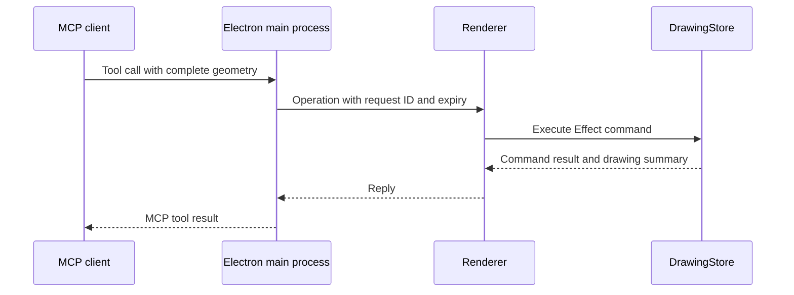

# MCP access to drawings

The standalone CLI and stdio MCP server read and edit local `.ecaddraw` files under Node. See [CLI and stdio access](#cli-and-stdio-access) below.

MCP clients can also read and edit the drawing open in the desktop app's editor. The web app has no MCP controls or endpoints.

## Connect a client to the desktop app

1. Start the desktop app, for example with `pnpm run dev:desktop`.
2. Click **Enable MCP** (the plug icon) in the sidebar. With no drawing open, it opens the project's main drawing first. Wait for **Connected to the open drawing**.
3. Click **Copy configuration**. Add the copied endpoint and authorization header to an MCP client that supports Streamable HTTP and custom headers.
4. Keep ECAD open while using the client. Click **MCP connected** to hide or show settings without disconnecting. Click **Disable MCP** in the settings panel to revoke access.

The panel provides a configuration in this form. Use the actual URL and token copied from the app:

```json
{
  "mcpServers": {
    "ecad": {
      "url": "http://127.0.0.1:<port>/mcp",
      "headers": {
        "Authorization": "Bearer <token>"
      }
    }
  }
}
```

The token grants read and edit access to the drawing open in the editor. Commands follow the editor: after you open another drawing, they run against that one.

## CLI and stdio access

The `@ecad/cli` workspace runs independently under Node. It uses `@ecad/drawing-core` for the drawing model, Effect commands, schemas, and MCP tool registration. The desktop editor uses the same implementation.

```bash
export ECAD_DRAWING="$PWD/drawing.ecaddraw"
pnpm --silent cli tools
pnpm --silent cli getDrawing
pnpm --silent cli placeRectangle '{"x":20,"y":30,"width":40,"height":15,"rotation":0,"lineWidth":0.2}'
pnpm --silent cli rotateShapes '{"ids":[1],"angle":1.5707963267948966}'
printf '%s' '{"ids":[1]}' | pnpm --silent cli removeShapes -
pnpm --silent cli undo
```

`--drawing <path>` overrides `ECAD_DRAWING`. The default is `drawing.ecaddraw` in the current directory. Its parent directory must exist. A missing drawing starts empty, and the first successful edit creates it. Reading an empty drawing or listing tools creates no drawing file.

All nine drawing tools are available by their MCP names. Arguments default to `{}`. `call <tool> [json|-]` handles tool names that conflict with CLI commands. `--timeout` sets the file lock wait in milliseconds, with a default of 30000. `--help` and `--version` run without loading drawing commands.

Successful tool calls print one MCP result as JSON on stdout. The tool reply is in `structuredContent` and in the text content. See [Replies and paging](#replies-and-paging) for what each reply contains. Tool failures preserve the MCP error result and return exit code 1. Argument errors use stderr and return exit code 1.

Build the executable once:

```bash
pnpm run build:cli
node packages/cli/bin/ecad.mjs --drawing drawing.ecaddraw getDrawing
node packages/cli/bin/ecad.mjs --drawing drawing.ecaddraw mcp
```

For an MCP client that launches stdio servers, use the absolute paths to the executable and drawing:

```json
{
  "mcpServers": {
    "ecad": {
      "command": "node",
      "args": [
        "/absolute/path/to/ecad/packages/cli/bin/ecad.mjs",
        "--drawing",
        "/absolute/path/to/drawing.ecaddraw",
        "mcp"
      ]
    }
  }
}
```

`ecad mcp` starts a local MCP server with the same tool schemas, annotations, and results as the desktop MCP server. Stdout contains only MCP messages. The server logs an input line that is not JSON, or not a JSON-RPC message, to stderr and keeps serving. Closing stdin closes the server once replies already handed to stdout are written. SIGINT, SIGTERM or SIGHUP stops running commands, waits until they release the drawing lock, and exits with code 130, 143 or 129 without waiting for stdout. CLI tool commands handle these signals the same way. A message over 10 MB, or a stdin or stdout failure, stops it with exit code 1.

Drawings use the app's JSON object format with a `shapes` array. Edits preserve other fields, including drawing IDs, names, and symbol library configuration. The adjacent `<drawing>.history.json` file stores undo branches and shape ID allocation across CLI calls and MCP restarts. Keep it with the drawing to retain history. An external change to the drawing starts a new history at that state.

Drawing history retains at most 100 nodes, including the current state, across all branches. Pruning removes the oldest leaf or oldest root with one child, preserving the current node and keeping the retained tree connected. A linear history permits 99 undo steps. Pruned entries cannot be restored, and retained entry IDs remain unchanged. The CLI compacts valid oversized legacy histories on the next successful operation, including `getDrawing`, using the same locked save path.

Each operation locks `<drawing>.lock`, reads the latest file, and publishes edits through temporary files and renames. Concurrent CLI and MCP processes share the same drawing and history. Programs that do not use this lock can still change files during an operation; the command checks for external changes before publishing. An interruption between publishing history and drawing data can reset history on the next read; the drawing itself always uses an atomic replacement. Saving keeps the existing files' permissions. A new history file copies its drawing's permissions, and other new files get the default permissions minus the umask. The CLI syncs each temporary file to disk before renaming it, then syncs the directory where the platform allows it.

A lock records its owner's process ID and host name. On Linux it also records the machine ID, boot ID, PID namespace and process start time. The CLI writes and syncs the lock before linking it into place, so a lock is never empty, even after a crash or power loss. When a command finds a lock whose process has exited, it removes the lock and continues. On Linux, that includes a lock from an earlier boot of the same machine and a lock whose process ID now belongs to a later process. Before removing a lock, a command creates a hidden `.ecad-claim-<owner ID>` file beside it, so only one process can remove that lock. Claims left by killed processes are removed the same way, through a claim of their own. After it removes an abandoned file, recovery also cleans the folder. It removes other claims whose owner exited, staged `.ecad-lock-<uuid>.tmp` copies whose owner exited, and readable but incomplete copies older than a minute. A paused process whose copy was removed stages a new one.

A lock blocks commands until the timeout when the CLI cannot prove that its owner exited. That happens when the lock comes from another computer or another PID namespace, such as a different container, and when the CLI cannot read it, as with locks from older CLI versions. On Linux, the CLI checks a process ID only when the lock and the current process both recorded the same boot ID and PID namespace. It compares start times only when `/proc` belongs to its own PID namespace. Other systems record neither, so the host name identifies the computer, and computers that share a drawing's folder need distinct host names. Linux computers that share a folder also need distinct machine IDs, as systemd requires. With a cloned `/etc/machine-id` and the same host name, the CLI takes another computer's lock for one left over from an earlier boot. Outside Linux, a lock whose process ID now belongs to another program also blocks until that program exits. Remove a blocking lock by hand only after checking that its process has stopped. On file systems without hard links, a crash between creating and writing a lock can leave it empty.

The package exports `runCli`, `createLocalDrawing`, `createLocalDrawingMcpServer`, and `serveStdioMcp` for other workspace modules. `createLocalDrawing` exposes an Effect executor. `createLocalDrawingMcpServer` returns the standalone MCP server for a chosen file.

## Tools and coordinates

Coordinates and dimensions are millimetres. `x` and `y` specify the shape center, positive Y points upward, and `rotation` is in radians. Width, height, rotation, and line width must be resolved before sending a placement command. Commands do not consult the active tool, pointer, or selection, and the editor does not snap their coordinates to the grid.

| Tool | Arguments | Behavior |
| --- | --- | --- |
| `getDrawing` | optional `offset`, `limit`, `revision` | Read committed shapes, schematic pages, nets, `nextShapeId`, and history entries. `offset` or `limit` reads one chunk of shapes; later chunks need the first chunk's `revision`. |
| `placeRectangle` | `x`, `y`, `width`, `height`, `rotation`, `lineWidth` | Place one rectangle and allocate its ID. |
| `placeShapes` | `shapes`, optional `label` | Place complete shapes without top-level IDs in one history transaction. |
| `replaceShapes` | `shapes`, optional `label`, optional `targetIds` | Replace complete geometry for explicit existing IDs. `targetIds` prefer IDs to retain when wires merge. A replacement without `page` puts the shape on the first page, so keep `page` from `getDrawing`. |
| `rotateShapes` | `ids`, optional `angle` | Rotate each explicit ID around its own center in one undo step. Relative radians, positive counterclockwise, default `Math.PI / 2`. Wires require multiples of `Math.PI / 2`. Unselected wires stay in place. All IDs must be on one page. |
| `removeShapes` | `ids`, optional `label` | Remove explicit existing IDs. |
| `undo` | `{}` | Restore the previous history entry. |
| `redo` | `{}` | Restore the preferred next history entry. |
| `jumpHistory` | `id` | Restore an existing history entry, including another branch. |
| `setPages` | `pages`, optional `label` | Replace the schematic page list to add, rename, reorder, or delete pages in one undo step. Shapes on a deleted page are deleted with it. |
| `moveShapesToPage` | `ids`, `page`, optional `label` | Move explicit existing IDs to another page at the same coordinates. Circuit labels pinned to a moved symbol move with it. Move connected wires and labels together, because wires connect only on their own page. |

For example, send this tool call to place a 40 × 15 mm rectangle centered at `(20, 30)`:

```json
{
  "name": "placeRectangle",
  "arguments": {
    "x": 20,
    "y": 30,
    "width": 40,
    "height": 15,
    "rotation": 0,
    "lineWidth": 0.2
  }
}
```

All six fields are required. The command commits immediately as one undo step. The standalone server saves it to the drawing file. With a desktop MCP connection, the edit appears in the open editor and leaves the selected tool unchanged.

`placeShapes` supports rectangles, circles, triangles, orthogonal wires, pins, text, and symbols. Pins have a string `name`, which defaults to empty when omitted, including pins inside symbols. Text includes its content, font size, and already measured width and height. Symbol children use coordinates relative to the symbol center and IDs local to the symbol. Read `getDrawing` before replacing or removing shapes, and include every connected neighbor that a replacement needs to move. The commands validate geometry and normalize overlapping wires; they do not infer an editor gesture.

Invalid input produces an MCP error and leaves drawing data and history unchanged. The tool schemas returned by `tools/list` describe the complete input and output formats.

### Replies and paging

Each tool returns its reply in `structuredContent` and as JSON text. Every successful reply has `ok: true` and a `summary` with `shapeCount`, `nextShapeId`, and `historyId`, the current history entry.

Edits do not return the drawing, so their replies stay small however large the drawing grows:

- `placeRectangle`, `placeShapes`, `replaceShapes`, `rotateShapes`, `moveShapesToPage`, `setPages`, and `removeShapes` also return `result.ids`, the committed IDs of the affected shapes. `removeShapes` and `setPages` return no IDs. `result.idMap` maps source IDs to committed IDs for the shapes in `result.ids` and for wires that normalization merged or renumbered. IDs it leaves out are unchanged.
- `undo`, `redo`, and `jumpHistory` return only the summary.

Call `getDrawing` to read committed geometry after an edit. It returns `drawing` with `shapes`, `pages`, `nets`, `nextShapeId`, and `history`. `pages` lists the schematic pages in order as `{ id, name }`. A shape's `page` field names its page; shapes on the first page omit it. Commands place a shape without `page` on the first page and reject a `page` the drawing does not have. Wires, pins, and symbol wire cuts connect only on one page; a net in `nets` spans pages when net or supply labels on them share a name. The page open in the editor is not drawing data, so placements do not follow it. The history includes entry IDs, labels, parents, children, and preferred redo branches. It excludes temporary previews, selection, and camera state.

An MCP tool result carries its reply twice: once as `structuredContent` and once as escaped JSON text. `getDrawing` sizes its reply so the whole serialized result stays within 8 MiB. That keeps it under the 10 MiB message limit of the MCP SDK's stdio transport. Without arguments, `getDrawing` returns the whole drawing, or fails with `DrawingTooLarge` when the result would not fit. To read a larger drawing, pass `offset: 0`. Then continue from `page.nextOffset`, passing the first page's `revision`, until a reply has no `nextOffset`:

```text
{ "name": "getDrawing", "arguments": { "offset": 0 } }
{ "name": "getDrawing", "arguments": { "offset": 1840, "revision": "<revision from the first page>" } }
```

Every `getDrawing` reply contains a `revision` derived from the drawing's shapes, schematic pages and ID allocation. Readers of the same content, including separate CLI processes, get the same revision, and any change to the shapes or pages produces a new one. That includes external edits to a CLI drawing, which reset its history. A page after offset 0 requires `revision`. When the drawing no longer matches it, the read fails with `DrawingChanged`; read again from offset 0. Without it, the read fails with `RevisionRequired`.

A paged reply also contains `page` with `offset`, `count`, `total`, and `nextOffset`. Each page returns as many shapes as fit, up to `limit` when given. Only the page at offset 0 includes `nets`, which cover the whole drawing. Every page includes the history. A drawing whose history and nets alone exceed the limit, or a single shape over the limit, fails with `DrawingTooLarge`. As a last check, a tool result that would still exceed 8 MiB becomes a `ReplyTooLarge` error. The connection stays open, but the command may have run, so read the drawing before retrying.

Desktop editor UI edits and MCP edits share the same history. An external mutation cancels an unfinished gesture before its preview can overwrite the command.

## Desktop connection lifetime

Disabling MCP, leaving the editor, opening the symbol editor, reloading or closing the window, or quitting the app stops the endpoint and revokes its token. Commands still waiting fail with `EditorDisconnected`. Enabling MCP again starts a new endpoint on a new port with a new token, so update the client's configuration after reconnecting.

A command the editor does not finish within 15 seconds fails with `EditorTimeout`. It may still have run. At most 128 commands wait for the editor at a time; more fail with `EditorBusy`. Disabling MCP does not undo completed edits.

## Request checks

The main process listens on `127.0.0.1` only, on a port the system picks. Every request must carry the bearer token. A request that carries an `Origin` header gets HTTP 403, because MCP clients send none and every web page does. A `Host` header other than `127.0.0.1:<port>` or `localhost:<port>` also gets HTTP 403, which stops DNS rebinding. MCP request bodies are limited to 1 MiB, below the editor's 2 MiB command limit; larger requests get HTTP 413.

## Desktop implementation

The MCP server in Electron's main process validates tool arguments and sends each complete operation to the renderer over IPC. The renderer runs its Effect command with the same `DrawingStore` used by `Editor2D`, one at a time in arrival order, and replies over IPC. React subscriptions update the display and Three.js renderer.



| Location | Responsibility |
| --- | --- |
| `packages/drawing-core/src/mcp/drawing-protocol.ts` | Shared operation schemas, reply schemas, and Effect command execution. |
| `packages/drawing-core/src/mcp/drawing-server.ts` | MCP tool registration and protocol results. |
| `packages/desktop/src/main/mcp-server.ts` | Localhost endpoint, token and request checks, pending commands, and timeouts. |
| `packages/desktop/src/renderer/mcp.ts` | Renderer side of the IPC bridge and command order. |
| `packages/core/src/mcp/editor-connection.ts` | Connector interface and command execution against a store. |
| `packages/core/src/components/editor/McpControls.tsx` | Enable/disable controls and client configuration. |

See [drawing architecture](architecture.md) for command and rendering boundaries, and [Effect integration](effect.md) for execution and resource lifetimes.
