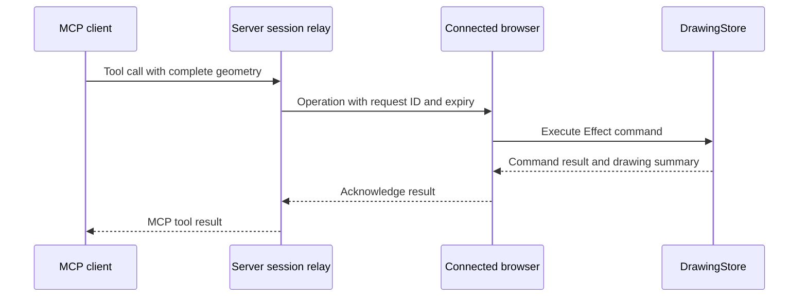

# MCP access to drawings

The standalone CLI and stdio MCP server read and edit local `.ecaddraw` files under Node. See [CLI and stdio access](#cli-and-stdio-access) below.

MCP clients can also read and edit the drawing open in the web app's `/editor`. Web editor MCP starts disabled. Each enabled editor has its own endpoint and bearer token, and commands run against that editor's existing `DrawingStore`. The desktop app uses the same editor with MCP controls hidden; it does not host these HTTP endpoints.

## Connect a client

1. Start the app with `pnpm run dev` and open `http://localhost:3000/editor`.
2. Click **Enable MCP** and wait for **Connected to this drawing**.
3. Click **Copy configuration**. Add the copied endpoint and authorization header to an MCP client that supports Streamable HTTP and custom headers.
4. Keep the drawing tab open while using the client. Click **MCP connected** to hide or show settings without disconnecting. Click **Disable MCP** in the settings panel to revoke access.

The panel provides a configuration in this form. Use the actual URL and token copied from the drawing:

```json
{
  "mcpServers": {
    "ecad": {
      "url": "http://localhost:3000/mcp/editor/<session-id>",
      "headers": {
        "Authorization": "Bearer <session-token>"
      }
    }
  }
}
```

Client configuration formats vary; the endpoint uses HTTP and requires the `Authorization: Bearer ...` header. The token grants read and edit access to this drawing. The client must be able to reach the app at the copied URL.

Drawing clients use the session-specific `/mcp/editor/<session-id>` endpoint. The app has no other public MCP endpoint.

## CLI and stdio access

The `@ecad/cli` workspace runs independently under Node. It uses `@ecad/drawing-core` for the drawing model, Effect commands, schemas, and MCP tool registration. The web editor uses the same implementation.

```bash
export ECAD_DRAWING="$PWD/drawing.ecaddraw"
pnpm --silent cli tools
pnpm --silent cli getDrawing
pnpm --silent cli placeRectangle '{"x":20,"y":30,"width":40,"height":15,"rotation":0,"lineWidth":0.2}'
pnpm --silent cli rotateShapes '{"ids":[1],"angle":1.5707963267948966}'
printf '%s' '{"ids":[1]}' | pnpm --silent cli removeShapes -
pnpm --silent cli undo
```

`--drawing <path>` overrides `ECAD_DRAWING`. The default is `drawing.ecaddraw` in the current directory. Its parent directory must exist. A missing drawing starts empty, and the first successful edit creates it. Reading an empty drawing or listing tools creates no drawing file.

All nine drawing tools are available by their MCP names. Arguments default to `{}`. `call <tool> [json|-]` handles tool names that conflict with CLI commands. `--timeout` sets the file lock wait in milliseconds, with a default of 30000. `--help` and `--version` run without loading drawing commands.

Successful tool calls print one MCP result as JSON on stdout. The tool reply is in `structuredContent` and in the text content. See [Replies and paging](#replies-and-paging) for what each reply contains. Tool failures preserve the MCP error result and return exit code 1. Argument errors use stderr and return exit code 1.

Build the executable once:

```bash
pnpm run build:cli
node packages/cli/bin/ecad.mjs --drawing drawing.ecaddraw getDrawing
node packages/cli/bin/ecad.mjs --drawing drawing.ecaddraw mcp
```

For an MCP client that launches stdio servers, use the absolute paths to the executable and drawing:

```json
{
  "mcpServers": {
    "ecad": {
      "command": "node",
      "args": [
        "/absolute/path/to/ecad/packages/cli/bin/ecad.mjs",
        "--drawing",
        "/absolute/path/to/drawing.ecaddraw",
        "mcp"
      ]
    }
  }
}
```

`ecad mcp` starts a local MCP server with the same tool schemas, annotations, and results as the web MCP server. Stdout contains only MCP messages. The server logs an input line that is not JSON, or not a JSON-RPC message, to stderr and keeps serving. Closing stdin closes the server once replies already handed to stdout are written. SIGINT, SIGTERM or SIGHUP stops running commands, waits until they release the drawing lock, and exits with code 130, 143 or 129 without waiting for stdout. CLI tool commands handle these signals the same way. A message over 10 MB, or a stdin or stdout failure, stops it with exit code 1.

Drawings use the app's JSON object format with a `shapes` array. Edits preserve other fields, including drawing IDs, names, and symbol library configuration. The adjacent `<drawing>.history.json` file stores undo branches and shape ID allocation across CLI calls and MCP restarts. Keep it with the drawing to retain history. An external change to the drawing starts a new history at that state.

Drawing history retains at most 100 nodes, including the current state, across all branches. Pruning removes the oldest leaf or oldest root with one child, preserving the current node and keeping the retained tree connected. A linear history permits 99 undo steps. Pruned entries cannot be restored, and retained entry IDs remain unchanged. The CLI compacts valid oversized legacy histories on the next successful operation, including `getDrawing`, using the same locked save path.

Each operation locks `<drawing>.lock`, reads the latest file, and publishes edits through temporary files and renames. Concurrent CLI and MCP processes share the same drawing and history. Programs that do not use this lock can still change files during an operation; the command checks for external changes before publishing. An interruption between publishing history and drawing data can reset history on the next read; the drawing itself always uses an atomic replacement. Saving keeps the existing files' permissions. A new history file copies its drawing's permissions, and other new files get the default permissions minus the umask. The CLI syncs each temporary file to disk before renaming it, then syncs the directory where the platform allows it.

A lock records its owner's process ID and host name. On Linux it also records the machine ID, boot ID, PID namespace and process start time. The CLI writes and syncs the lock before linking it into place, so a lock is never empty, even after a crash or power loss. When a command finds a lock whose process has exited, it removes the lock and continues. On Linux, that includes a lock from an earlier boot of the same machine and a lock whose process ID now belongs to a later process. Before removing a lock, a command creates a hidden `.ecad-claim-<owner ID>` file beside it, so only one process can remove that lock. Claims left by killed processes are removed the same way, through a claim of their own. After it removes an abandoned file, recovery also cleans the folder. It removes other claims whose owner exited, staged `.ecad-lock-<uuid>.tmp` copies whose owner exited, and readable but incomplete copies older than a minute. A paused process whose copy was removed stages a new one.

A lock blocks commands until the timeout when the CLI cannot prove that its owner exited. That happens when the lock comes from another computer or another PID namespace, such as a different container, and when the CLI cannot read it, as with locks from older CLI versions. On Linux, the CLI checks a process ID only when the lock and the current process both recorded the same boot ID and PID namespace. It compares start times only when `/proc` belongs to its own PID namespace. Other systems record neither, so the host name identifies the computer, and computers that share a drawing's folder need distinct host names. Linux computers that share a folder also need distinct machine IDs, as systemd requires. With a cloned `/etc/machine-id` and the same host name, the CLI takes another computer's lock for one left over from an earlier boot. Outside Linux, a lock whose process ID now belongs to another program also blocks until that program exits. Remove a blocking lock by hand only after checking that its process has stopped. On file systems without hard links, a crash between creating and writing a lock can leave it empty.

The package exports `runCli`, `createLocalDrawing`, `createLocalDrawingMcpServer`, and `serveStdioMcp` for other workspace modules. `createLocalDrawing` exposes an Effect executor. `createLocalDrawingMcpServer` returns the standalone MCP server for a chosen file.

## Tools and coordinates

Coordinates and dimensions are millimetres. `x` and `y` specify the shape center, positive Y points upward, and `rotation` is in radians. Width, height, rotation, and line width must be resolved before sending a placement command. Commands do not consult the active tool, pointer, or selection, and the editor does not snap their coordinates to the grid.

| Tool | Arguments | Behavior |
| --- | --- | --- |
| `getDrawing` | optional `offset`, `limit`, `revision` | Read committed shapes, nets, `nextShapeId`, and history entries. `offset` or `limit` reads one page of shapes; later pages need the first page's `revision`. |
| `placeRectangle` | `x`, `y`, `width`, `height`, `rotation`, `lineWidth` | Place one rectangle and allocate its ID. |
| `placeShapes` | `shapes`, optional `label` | Place complete shapes without top-level IDs in one history transaction. |
| `replaceShapes` | `shapes`, optional `label`, optional `targetIds` | Replace complete geometry for explicit existing IDs. `targetIds` prefer IDs to retain when wires merge. |
| `rotateShapes` | `ids`, optional `angle` | Rotate each explicit ID around its own center in one undo step. Relative radians, positive counterclockwise, default `Math.PI / 2`. Wires require multiples of `Math.PI / 2`. Unselected wires stay in place. |
| `removeShapes` | `ids`, optional `label` | Remove explicit existing IDs. |
| `undo` | `{}` | Restore the previous history entry. |
| `redo` | `{}` | Restore the preferred next history entry. |
| `jumpHistory` | `id` | Restore an existing history entry, including another branch. |
| `setPages` | `pages`, optional `label` | Replace the schematic page list to add, rename, reorder, or delete pages in one undo step. Shapes on a deleted page are deleted with it. |
| `moveShapesToPage` | `ids`, `page`, optional `label` | Move explicit existing IDs to another page at the same coordinates. |

For example, send this tool call to place a 40 × 15 mm rectangle centered at `(20, 30)`:

```json
{
  "name": "placeRectangle",
  "arguments": {
    "x": 20,
    "y": 30,
    "width": 40,
    "height": 15,
    "rotation": 0,
    "lineWidth": 0.2
  }
}
```

All six fields are required. The command commits immediately as one undo step. The standalone server saves it to the drawing file. With a web MCP connection, the edit appears in the open editor and leaves the selected tool unchanged.

`placeShapes` supports rectangles, circles, triangles, orthogonal wires, pins, text, and symbols. Pins have a string `name`, which defaults to empty when omitted, including pins inside symbols. Text includes its content, font size, and already measured width and height. Symbol children use coordinates relative to the symbol center and IDs local to the symbol. Read `getDrawing` before replacing or removing shapes, and include every connected neighbor that a replacement needs to move. The commands validate geometry and normalize overlapping wires; they do not infer an editor gesture.

Invalid input produces an MCP error and leaves drawing data and history unchanged. The tool schemas returned by `tools/list` describe the complete input and output formats.

### Replies and paging

Each tool returns its reply in `structuredContent` and as JSON text. Every successful reply has `ok: true` and a `summary` with `shapeCount`, `nextShapeId`, and `historyId`, the current history entry.

Edits do not return the drawing, so their replies stay small however large the drawing grows:

- `placeRectangle`, `placeShapes`, `replaceShapes`, `rotateShapes`, `moveShapesToPage`, `setPages`, and `removeShapes` also return `result.ids`, the committed IDs of the affected shapes. `removeShapes` and `setPages` return no IDs. `result.idMap` maps source IDs to committed IDs for the shapes in `result.ids` and for wires that normalization merged or renumbered. IDs it leaves out are unchanged.
- `undo`, `redo`, and `jumpHistory` return only the summary.

Call `getDrawing` to read committed geometry after an edit. It returns `drawing` with `shapes`, `pages`, `nets`, `nextShapeId`, and `history`. `pages` lists the schematic pages in order as `{ id, name }`. A shape's `page` field names its page; shapes on the first page omit it. Commands place a shape without `page` on the first page and reject a `page` the drawing does not have. The history includes entry IDs, labels, parents, children, and preferred redo branches. It excludes temporary previews, selection, and camera state.

An MCP tool result carries its reply twice: once as `structuredContent` and once as escaped JSON text. `getDrawing` sizes its reply so the whole serialized result stays within 8 MiB. That keeps it under the 10 MiB message limit of the MCP SDK's stdio transport, and keeps the reply itself small enough for one editor acknowledgement. Without arguments, `getDrawing` returns the whole drawing, or fails with `DrawingTooLarge` when the result would not fit. To read a larger drawing, pass `offset: 0`. Then continue from `page.nextOffset`, passing the first page's `revision`, until a reply has no `nextOffset`:

```text
{ "name": "getDrawing", "arguments": { "offset": 0 } }
{ "name": "getDrawing", "arguments": { "offset": 1840, "revision": "<revision from the first page>" } }
```

Every `getDrawing` reply contains a `revision` derived from the drawing's shapes and ID allocation. Readers of the same content, including separate CLI processes, get the same revision, and any change to the shapes produces a new one. That includes external edits to a CLI drawing, which reset its history. A page after offset 0 requires `revision`. When the drawing no longer matches it, the read fails with `DrawingChanged`; read again from offset 0. Without it, the read fails with `RevisionRequired`.

A paged reply also contains `page` with `offset`, `count`, `total`, and `nextOffset`. Each page returns as many shapes as fit, up to `limit` when given. Only the page at offset 0 includes `nets`, which cover the whole drawing. Every page includes the history. A drawing whose history and nets alone exceed the limit, or a single shape over the limit, fails with `DrawingTooLarge`. As a last check, a tool result that would still exceed 8 MiB becomes a `ReplyTooLarge` error, and so does a web editor acknowledgement over the relay's limit. The connection stays open, but the command may have run, so read the drawing before retrying.

Web editor UI edits and HTTP MCP edits share the same history. An external mutation cancels an unfinished gesture before its preview can overwrite the command.

## Web session lifetime

Disabling MCP, closing the tab, leaving the editor, or losing its command stream revokes the session credentials. Enabling MCP again creates a new endpoint and token. Update the client's configuration after reconnecting. Separate editor tabs have separate sessions and drawings.

The server also ends sessions on its own:

| Session state | Ends after |
| --- | --- |
| Created, editor stream not yet open | 60 seconds |
| Connected, no MCP requests | 30 minutes |
| Connected, any activity | 8 hours from creation |

Only requests to the MCP endpoint reset the idle timer. The stream heartbeat does not. When a session ends, the editor shows that the connection closed, and commands still waiting fail with `EditorDisconnected`.

The browser does not automatically reconnect or replay commands. A timeout, caller cancellation, or failed acknowledgement can occur after a command has reached the browser. Cancellation does not retract a delivered command or roll back its mutation. Inspect the drawing before retrying; after enabling a fresh connection, use `getDrawing` to check the committed state. Disabling MCP does not undo completed edits.

## Limits and request checks

The session endpoints need no login, so the relay limits what one client can hold:

- One client can hold 4 sessions at a time. A fifth **Enable MCP** fails with `ClientSessionLimit` (HTTP 429) until another drawing disables MCP or a session ends.
- The server holds at most 100 sessions. When all are in use, new sessions fail with `SessionLimit` (HTTP 503).
- Each session queues at most 128 commands for its editor.
- While the editor is not reading its command stream, the relay holds at most 8 MiB of undelivered commands for it. Network and browser buffers can hold more data in transit. A command that would exceed that fails with `EditorBacklogged` (HTTP 429) and is not delivered. Commands that time out or are cancelled before delivery are dropped from the relay's queue and never reach the editor.

The client key is the connecting IP address. All IPv6 addresses in one /64 network count as one client, because a single host can usually pick any address in its /64. IPv4-mapped IPv6 addresses count as their IPv4 address. Clients behind one NAT share a key and its 4 sessions.

The relay ignores `X-Forwarded-For` by default, because any client can send that header. It uses the peer address that the runtime exposes as `request.ip`:

- Under `pnpm run dev` and `pnpm run preview`, that is the TCP peer.
- On Vercel, Nitro sets it from `X-Forwarded-For`. Vercel overwrites that header with the client address, so clients cannot spoof it there.
- Behind your own reverse proxy, every client would share the proxy's address. Set `ECAD_TRUSTED_PROXY_HOPS` to the number of proxies that append the connecting address to `X-Forwarded-For`, for example `1` for nginx with `proxy_set_header X-Forwarded-For $proxy_add_x_forwarded_for`. The relay then reads that many entries from the right of the header and ignores entries further left, which the client wrote. Set it only when clients cannot reach the app server except through those proxies.
- The relay strips a port from `X-Forwarded-For` entries such as `192.0.2.4:4444` and `[2001:db8::1]:4444`. Entries it can't parse as an address all count as one shared client.

The editor endpoints, `POST /api/editor-mcp` and `/api/editor-mcp/<session-id>`, accept only same-origin browser requests. A request needs an `Origin` header matching the app's origin, or `Sec-Fetch-Site: same-origin` when it has no `Origin`. Browsers send `Origin` on POST and DELETE and send `Sec-Fetch-Site` on every request from a secure context, which covers the GET command stream. Open the editor over HTTPS or `localhost`, since browsers omit `Sec-Fetch-Site` on plain HTTP to other hosts. These endpoints reject requests without either header, such as requests from scripts. They compare `Origin` with the request URL the app server sees. Behind a proxy that terminates HTTPS and forwards plain HTTP, that URL starts with `http://`, so the browser's `https://` origin does not match and these endpoints return HTTP 403.

The MCP endpoint `/mcp/editor/<session-id>` does not require `Origin`, because MCP clients do not send one. The MCP token authenticates them. A request that does carry a different `Origin` gets HTTP 403.

Request bodies have size limits. The relay checks `Content-Length` and stops reading once a body passes the limit, so a missing or false length does not get around it. Oversized requests get HTTP 413.

| Endpoint | Body limit |
| --- | --- |
| MCP requests | 1 MiB, below the editor's 2 MiB command limit |
| Editor acknowledgements, which include at most one drawing reply | 8 MiB |
| Session creation, stream, and disconnect | 1 KiB |

## Web implementation and hosting

The MCP server validates tool arguments and forwards a complete operation to the connected browser. The browser executes its Effect command with the same `DrawingStore` used by `Editor2D`, then acknowledges the result. React subscriptions update the display and Three.js renderer.



| Location | Responsibility |
| --- | --- |
| `packages/drawing-core/src/mcp/drawing-protocol.ts` | Shared operation schemas, reply schemas, and Effect command execution. |
| `packages/drawing-core/src/mcp/drawing-server.ts` | MCP tool registration and protocol results. |
| `packages/core/src/mcp/editor-connection.ts` | Browser command stream, validation, execution, and acknowledgement. |
| `packages/core/src/services/server/editor-sessions.ts` | Session credentials, connected browsers, pending requests, and timeouts. |
| `packages/core/src/services/server/editor-mcp.ts` | HTTP handlers for session creation, browser connections, and MCP requests. |
| `packages/core/src/components/editor/McpControls.tsx` | Explicit enable/disable controls and client configuration. |

`POST /api/editor-mcp` creates a session. The browser connects to `/api/editor-mcp/<session-id>` using a separate editor token, receives newline-delimited operations, and posts acknowledgements there. MCP clients authenticate to `/mcp/editor/<session-id>` with the copied MCP token. The browser token is not included in the client configuration.

The relay currently stores sessions and pending requests in one server process. It stores no drawing document. All creation, browser stream, acknowledgement, and MCP requests for a session must reach that same process. Deploy with one process, or provide session-aware sticky routing across both browser and MCP client requests. Independently routed serverless requests or multiple workers need a shared relay implementation. Server restarts invalidate existing connections.

The Vercel deployment does not meet these conditions, so web editor MCP is unreliable there:

- Vercel runs the app as Vercel Functions through the Nitro adapter. Each function instance has its own copy of the relay. Nothing routes a session's MCP requests to the instance that holds its editor stream. A request that reaches another instance gets HTTP 401, as if the token were wrong.
- The editor stream is one long function invocation. Vercel stops invocations at the maximum function duration, 300 seconds by default. The stream then closes and the session ends, so the editor needs **Enable MCP** again at least every 5 minutes.

Use `pnpm run dev`, `pnpm run preview`, or another single Node process for web editor MCP.

Keep the browser response stream open through any reverse proxy and disable response buffering for that endpoint. Idle streams send a heartbeat every 15 seconds. Drawing commands currently have a 15-second acknowledgement timeout.

See [drawing architecture](architecture.md) for command and rendering boundaries, and [Effect integration](effect.md) for execution and resource lifetimes.
